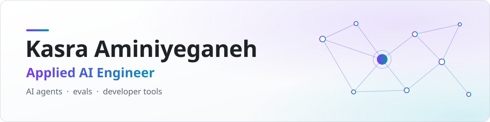
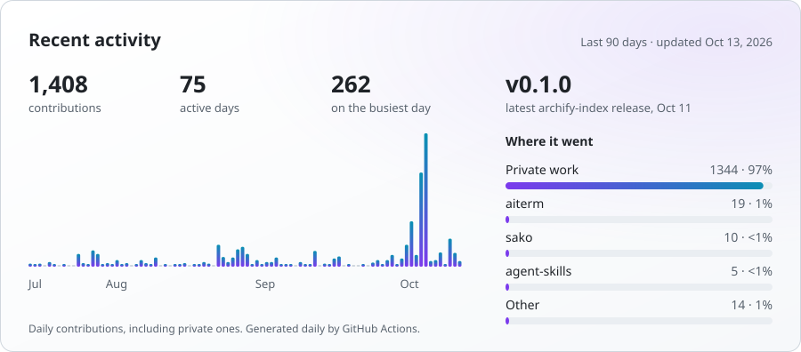

<picture>
  <source media="(prefers-color-scheme: dark)" srcset="assets/banner-dark.svg">
  <source media="(prefers-color-scheme: light)" srcset="assets/banner-light.svg">
  
</picture>

I build AI agents and the tools around them, and test where they fail. Before agents, I spent years on backend systems where a bug costs real money, from payment callbacks at a fintech in Tehran to in-game currency services at Xsolla. I write about the work at [thakay.dev](https://thakay.dev).

## Featured work

- **[Crexil](https://github.com/Thakay/crexil)** 
  Sends one brief to several AI models for images, voices, sound effects and 3D, hosted or on your own GPU, and records each pick with who made it and what it beat. Agents drive it through an MCP server and a voice director on ElevenAgents, within spending limits a person sets. Python and TypeScript.
- **[SAKO](https://github.com/Thakay/sako)** &nbsp; 
  Helps coding agents prove their work. When a Claude Code or Codex session stops, a finish gate flags changes that are not recorded, checked or committed, and each finished task gets a receipt. Pure Python, no dependencies; in alpha.
- **[ste-eval](https://github.com/Thakay/ste-eval)** 
  A blind-judged eval harness for coding agents running inside their own CLIs. It scored 224 Claude Code and Codex replies with judges from both model families. Read [what it found](https://blog.thakay.dev/asd-ste100-and-llms/) and [what almost fooled it](https://blog.thakay.dev/what-almost-fooled-my-eval/).
- **[aiterm](https://github.com/Thakay/aiterm)** &nbsp; 
  Turns plain-English requests into Unix commands in your terminal, and lets you run, copy or edit each one before it executes. Go and the OpenAI API.
- **[object-detect](https://github.com/Thakay/object-detect)** 
  Benchmarks real-time object detection on a Raspberry Pi, CPU versus a Coral Edge TPU. Tracks FPS, CPU, memory and temperature for SSD MobileNet, EfficientDet-Lite and YOLOv5.
- **Open source:** merged [a cleanup to AutoGPT's memory module](https://github.com/Significant-Gravitas/AutoGPT/pull/1068) (2023).

Earlier work: <a href="https://github.com/Thakay/BayesianQRL">Bayesian Q-learning</a>, a reproduction of Dearden et al. (1998) in OpenAI Gym · <a href="https://github.com/Thakay/saytext">saytext</a>, a text-to-speech service over gRPC in Go

## Activity

<picture>
  <source media="(prefers-color-scheme: dark)" srcset="profile/activity-dark.svg">
  <source media="(prefers-color-scheme: light)" srcset="profile/activity-light.svg">
  
</picture>

<picture>
  <source media="(prefers-color-scheme: dark)" srcset="profile/stats-dark.svg">
  <source media="(prefers-color-scheme: light)" srcset="profile/stats-light.svg">
  
</picture>

<b>Stack</b>

 

- **AI engineering:** LLM evaluation, guardrails, human-in-the-loop review, MCP servers, RAG, Claude Code, Codex, ElevenAgents, OpenRouter
- **ML:** TensorFlow Lite, YOLOv5, OpenCV
- **Languages and front end:** Python, Go, TypeScript, SQL, React
- **Backend and data:** FastAPI, asyncio, Pydantic, REST and OpenAPI, gRPC, event-driven services, PostgreSQL, SQLite
- **Cloud and infrastructure:** Docker, Kubernetes, Google Cloud, AWS, GitHub Actions, OpenTelemetry, Datadog, Linux

## Let's work together

I'm open to applied AI roles and to collaborating on coding-agent tooling, LLM developer tools, and AI features that need solid infrastructure.

- **Use Claude Code or Codex?** Try [SAKO](https://github.com/Thakay/sako) with `uvx sako init` and tell me what breaks. Issues and client test reports are welcome.
- **Have a project or role in mind?** [Send a collaboration request](https://github.com/Thakay/Thakay/issues/new?template=collaborate.yml).

The activity and stats cards are rebuilt daily by <a href=".github/workflows/profile-cards.yml">a GitHub Action</a> in this repo.
